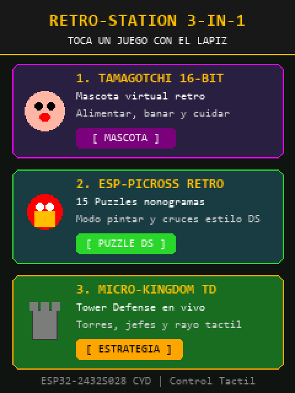
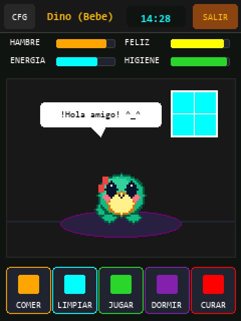
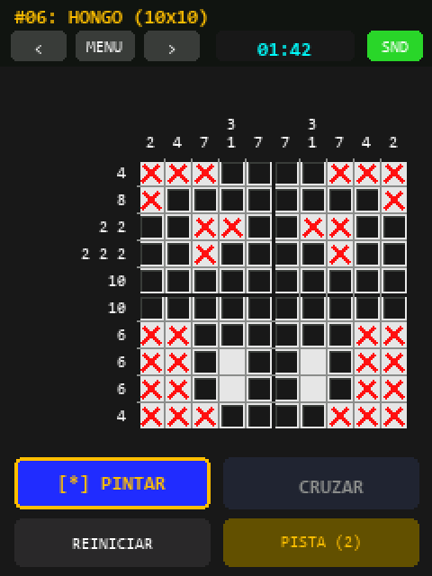
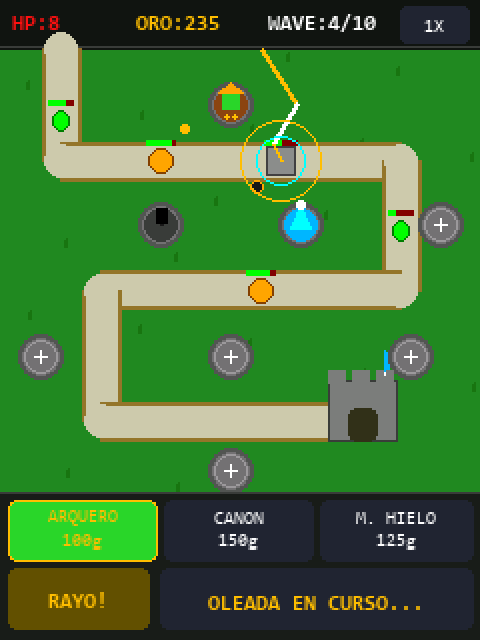

# 🎮 RetroStation 4-in-1 (ESP32-CYD)

Consola portátil retro multitarea 4-en-1 para la placa **ESP32-2432S028 ("Cheap Yellow Display" / CYD)** con pantalla táctil TFT resistiva de 2.8" (240x320) y zumbador piezoeléctrico.

Incluye un menú lanzador interactivo al encender la placa que permite elegir a cuál de los 4 juegos jugar con el lápiz táctil (*stylus*), y volver en cualquier momento al menú principal sin apagar el dispositivo.

---

## 📸 Capturas de Pantalla

<div align="center">
  
  
  <br/><br/>
  
  
</div>

---

## 🕹️ Juegos Incluidos

### 1. 🐣 Tamagotchi 16-Bit Retro Edition
* **Motor:** LVGL 8.3.11 con interfaz gráfica avanzada y widgets táctiles.
* **Características:**
  * Elección entre 3 mascotas: **Dino Dragón**, **Pollito Polli** y **Gatita Mimi**.
  * Evolución por edad y cuidados: Huevo ➔ Bebé ➔ Joven ➔ Adulto.
  * Cuidados activos: Alimentación, baño/limpieza de suciedad, juego, descanso y medicina.
  * Modos día/noche con reloj en tiempo real sincronizado por NTP vía WiFi opcional.
  * Botón directo **[ SALIR ]** en la barra superior, en la pantalla de selección y en la ventana de configuración.

### 2. 🧩 ESP-Picross DS
* **Motor:** LovyanGFX con gráficos optimizados directos a framebuffer.
* **Características:**
  * 15 rompecabezas nonogramas clásicos estilo Nintendo DS (5x5, 10x10).
  * Control por stylus con soporte para arrastre rápido (*drag*), modo marcar celdas y modo tachar con cruces [X].
  * Pistas inteligentes, cronómetro en vivo y guardado automático de mejores tiempos en memoria NVS.
  * Botón **[ 🏠 MENU ]** para salir a la selección de puzles y botón **[ 🏠 HOME ]** para regresar al lanzador.

### 3. 🏰 Micro-Kingdom: Tower Defense Táctil
* **Motor:** Doble búfer con `LGFX_Sprite` para 30+ FPS suaves y renderizado sin parpadeos (*Zero-Flicker*).
* **Características:**
  * Estrategia en tiempo real con 10 oleadas de invasores progresivas (Goblins veloces, Orcos, Gólems blindados y Jefe Dragón Supremo de 2.200 HP).
  * 3 tipos de torres con sinergias tácticas y 3 niveles de mejora:
    * **Arqueros (85g):** Cadencia rápida (2.5 disparos/s) eficaz contra enjambres veloces.
    * **Cañón (160g):** Artillería pesada con gran daño en área y dispersión contra frentes blindados.
    * **Mago de Hielo (115g):** Nueva escarcha en área (radio 26 px) ralentizando al 50% durante 3.2s.
  * Hechizo táctil interactivo de **Rayo Celestial** tocando a los enemigos directamente en la pantalla con el lápiz táctil (10s de recarga).
  * Pantalla final de Victoria y Derrota protegida contra toques accidentales (filtro *debounce* de 800 ms) con opciones para **JUGAR DE NUEVO** o **SALIR AL LANZADOR**.
  * Gestión de oro inicial (140g), vidas del castillo, velocidad de juego (1x / 2x), y botón **[ 🏠 ]** en el HUD superior para volver al lanzador.

### 4. 🗡️ Pocket Dungeon: Rogue Dice Crawler
* **Motor:** LovyanGFX con interfaz táctil de cartas y dados inspirada en *One Deck Dungeon*.
* **Características:**
  * 3 clases de héroe con atributos y habilidades únicas: **Guerrero** (Fuerza 🟡), **Pícara** (Agilidad 🟢) y **Maga** (Magia 🔵).
  * 3 pisos de mazmorra con encuentros generados al azar y Jefe Final: el temible **Dragón Rojo**.
  * Combate por asignación de dados: tira tu reserva y coloca los dados en casillas que cumplan color y valor mínimo.
  * Asignación táctica manual mediante stylus o instantánea con el botón **[ AUTO ]**.
  * Sistema de botín multifunción: cada carta vencida se reclama como **Objeto (+1 Dado permanente)**, **Poción (+3 HP)** o **Experiencia (XP)** para subir de nivel y desbloquear dados comodín.
  * Botón **[ SALIR ]** en el HUD superior para volver al lanzador en cualquier instante.

---

## 🚀 Menú Lanzador 4-en-1 & Arquitectura de Memoria

El firmware utiliza una arquitectura con el esquema de particiones **`huge_app.csv`** (3.14 MB de Flash para código):

```
Flash ESP32 (4 MB):
┌──────────────────────────────────────────────┬─────────────┐
│           App Partition (3.14 MB)            │   NVS / OT  │
│  [Launcher + Gotchi + Picross + TD + Dungeon]│ (Partidas)  │
└──────────────────────────────────────────────┴─────────────┘
  Ocupación actual: ~1.19 MB (38.0%) | RAM: ~30.9%
```

### Cambio Limpio entre Juegos
1. Al encender la placa o conectarla por USB (`ESP_RST_POWERON`), arranca siempre en el **Menú Lanzador 3-en-1**.
2. Al tocar una tarjeta de juego, se almacena el ID del juego en NVS y se reinicia en caliente (`ESP.restart()`, ~180ms).
3. Esto garantiza que la memoria RAM y el *heap* queden 100% limpios al cambiar entre juegos basados en LVGL y juegos basados en Sprites con doble búfer.
4. Al pulsar el botón **[ SALIR ]** o **[ HOME ]** en cualquiera de los tres juegos, el sistema vuelve limpiamente al menú de inicio.

---

## 🛠️ Conexiones Hardware (ESP32-2432S028 CYD)

| Periférico | Pin ESP32 | Descripción |
|---|---|---|
| **TFT MOSI** | GPIO 13 | Bus HSPI Display |
| **TFT MISO** | GPIO 12 | Bus HSPI Display |
| **TFT SCLK** | GPIO 14 | Reloj SPI Display |
| **TFT CS** | GPIO 15 | Chip Select TFT |
| **TFT DC** | GPIO 2 | Data/Command |
| **TFT Backlight** | GPIO 21 | Control PWM Brillo |
| **Touch MOSI** | GPIO 32 | Soft-SPI XPT2046 |
| **Touch MISO** | GPIO 39 | Soft-SPI XPT2046 |
| **Touch CLK** | GPIO 25 | Reloj Táctil |
| **Touch CS** | GPIO 33 | Chip Select Táctil |
| **Touch IRQ** | GPIO 36 | Interrupción Táctil |
| **Buzzer** | GPIO 26 | Zumbador PWM / Audio |
| **RGB LED** | GPIO 4 (R), 16 (G), 17 (B) | LED de Estado (Active-LOW) |

---

## 💻 Compilación e Instalación

### Requisitos
* [Visual Studio Code](https://code.visualstudio.com/) con la extensión [PlatformIO IDE](https://platformio.org/).

### Pasos
1. Clona o copia la carpeta del proyecto:
   ```bash
   cd esp32_3in1
   ```
2. Compila el firmware:
   ```bash
   pio run
   ```
3. Conecta la placa ESP32 por USB y sube el firmware:
   ```bash
   pio run -t upload
   ```
4. Abre el monitor serie a 115200 baudios si deseas ver el log de arranque:
   ```bash
   pio run -t monitor
   ```

---

## 👤 Autor

* **jgferrer** (<jgabriel.ferrer@gmail.com>)

## 📄 Licencia

Este proyecto está bajo la Licencia MIT.
